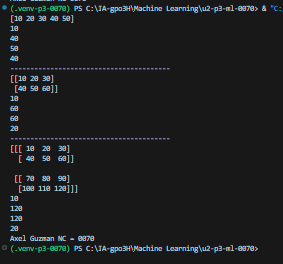

arre: Variable donde se guarda el arreglo generado.
np.linspace(): Función de NumPy que genera números distribuidos uniformemente dentro de un intervalo.
start=0: Indica el valor inicial, que es 0.
stop=1: Indica el valor final, que es 1.
num=5: Indica la cantidad de números que se van a generar, en este caso, 5.

## que es np.linspace
linspace() es una función de NumPy que genera una cantidad específica de números distribuidos uniformemente entre un valor inicial y uno final.

## el codigo

## el resultado
